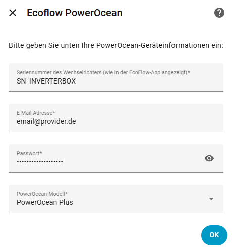
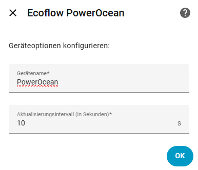
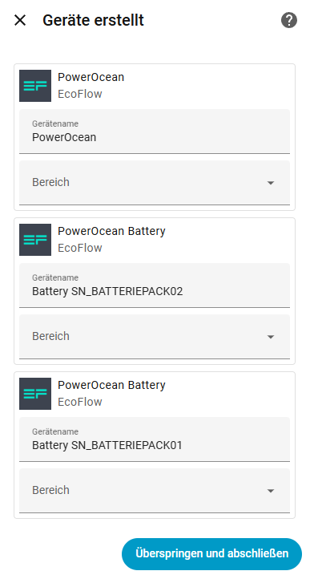
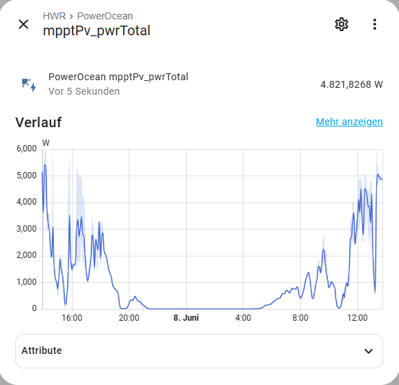
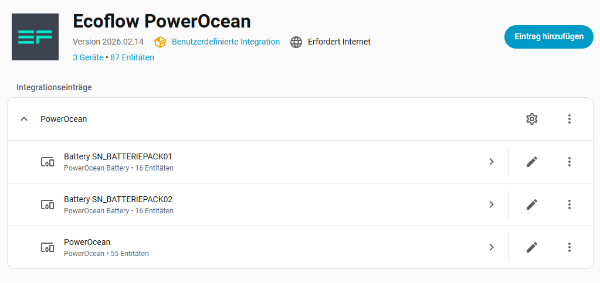
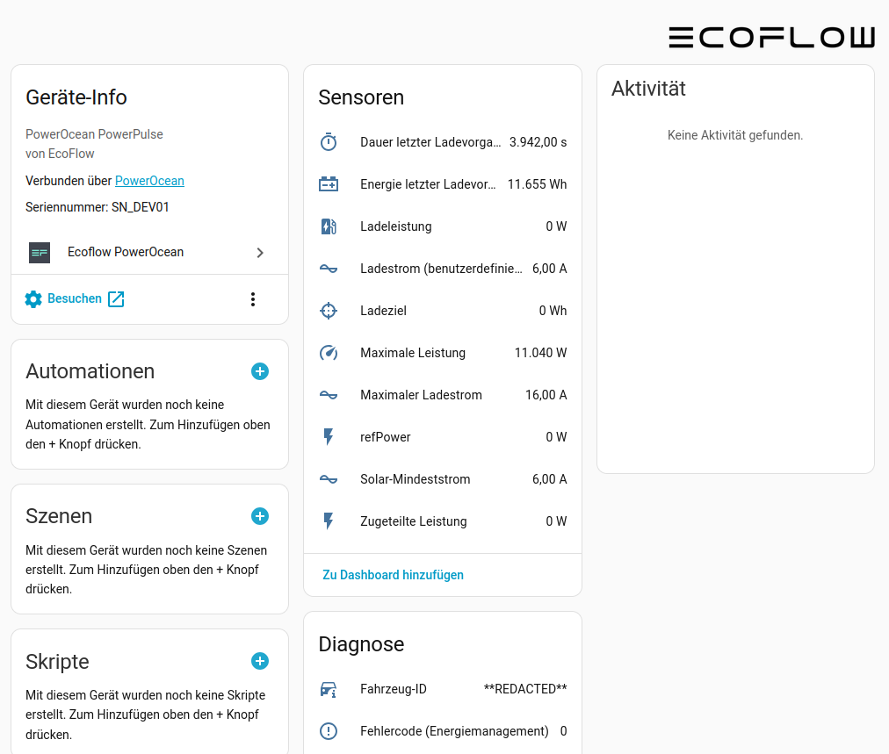
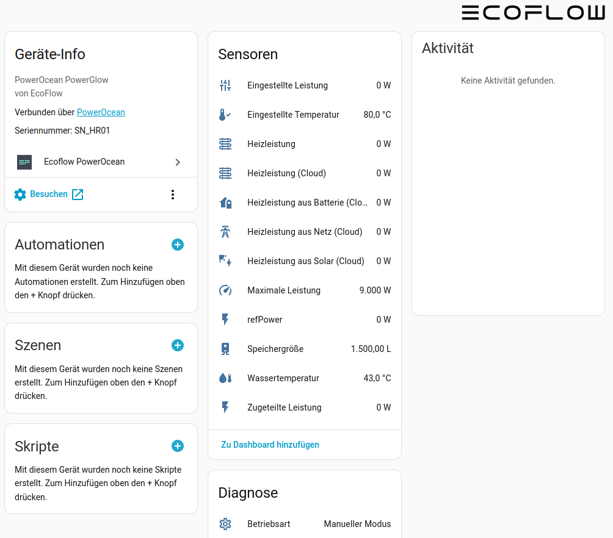
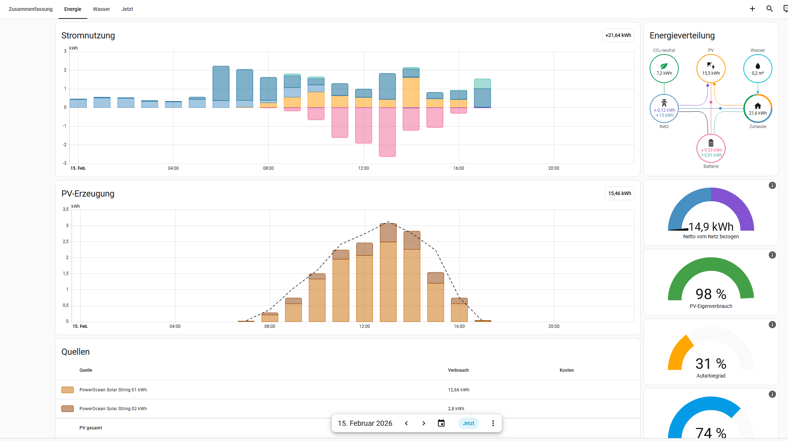

<!-- prettier-ignore -->
# Ecoflow PowerOcean
[](https://github.com/niltrip/powerocean/releases/)
[](https://github.com/niltrip/powerocean/issues)
[](https://github.com/niltrip/powerocean)
[](https://github.com/niltrip/powerocean/commits/main)
[](https://github.com/hacs/integration)
[](https://github.com/niltrip/powerocean/actions?query=workflow:"Validate")


[Home Assistant](https://home-assistant.io/) custom component to get access to my EcoFlow PowerOcean system.

This component was inspired by [tolwi/hassio-ecoflow-cloud](https://github.com/tolwi/hassio-ecoflow-cloud) and is a copy of [evercape/hass-resol-KM2](https://github.com/evercape/hass-resol-KM2).

## Disclaimers

⚠️ Temporary quick solution to my problem ("Nothing is more persistent than a makeshift solution.").
I hope for an integration of PowerOcean into [tolwi/hassio-ecoflow-cloud](https://github.com/tolwi/hassio-ecoflow-cloud) with an official API.

Nevertheless, I hope that it works for others as well.

## Prerequisites

- Home Assistant **2025.8.0** or newer
- The serial number (S/N) of your inverter, as shown in the EcoFlow app
- The e-mail address and password of your EcoFlow account

I have tested the component with my system.
I use the Android app and the web portal at https://user-portal.ecoflow.com/

## Installation

- Install as a custom repository via HACS
- Manually download and extract to the custom_components directory

Once installed, use Add Integration -> Ecoflow PowerOcean.

## Configuration

Follow the flow.






### Sensors
Sensors are registered to their device as `sensor.{device_name}_{sensor_name}` with the friendly name `sensor_name`, the name of the value in the EcoFlow API.
The unique ID is `{serial}_{report}_{sensor_name}`, e.g. `{serial}_JTS1_EMS_HEARTBEAT_pcsMeterPower`, or `{serial}_{sensor_name}` for values outside a report.

Each sensor has these attributes:
- `product_description`: description of the value, if known (otherwise its name)
- `product_serial`: serial number of the device the value belongs to

### Active errors
The sensor `errorCount` (description "Aktive Fehler") of each inverter counts the errors the system currently reports, as the app shows them: from the EMS, the inverter (PCS) and the battery packs.
Its attribute `errors` lists each active error with module, serial number of the module and error code; for known codes also name and level (Info, Warning, Error):

```yaml
errors:
  - module: ems
    module_sn: ...
    code: 521
    name: Energy storage communication error
    level: Warning
```

Cause and solution are only available in the [EcoFlow web portal](https://user-portal.ecoflow.com/); the attribute `error_details` points there. The link "Visit" on the device page opens the portal as well.

<!-- Screenshot: documentation/error_sensor.png (sensor errorCount with its attributes; black out serial numbers) -->

### Which values update, and which do not

The EcoFlow cloud does not refresh all values at the same rate. Some of them keep returning the same number for hours. The integration reports what the API hands it, so a flat line here is not a bug in this component.

Measured on my own system over 72 hours (three-phase PowerOcean, one battery, release 2026.03.04):

| sensor | report | distinct values in 72 h |
|---|---|---|
| `mpptPwr`, `bpPwr` | `data` | 1 (always 0 W) |
| `pv1Pwr`, `pv2Pwr`, `pvInvPwr` | `ENERGY_STREAM_REPORT` | 1 (always 0 W) |
| `sysGridPwr`, `sysLoadPwr` | `data` | 4 |
| `todayElectricityGeneration` | `data` | about one per hour |
| `pcsMeterPower`, `pcsActPwr`, `mpptPv_pwrTotal` | `EMS_HEARTBEAT` | more than 2100 |

On 2026-08-21 at 13:16 `mpptPwr` read 0 W while `mpptPv_pwrTotal` read 4238 W. Both describe the same solar power, and both came out of the same response.

Others report in [#34](https://github.com/niltrip/powerocean/issues/34) and [#28](https://github.com/niltrip/powerocean/issues/28) that these values start moving again while the app or the web portal is open. I cannot confirm that part myself.

For a dashboard, take the values from `EMS_HEARTBEAT`:

- grid: `pcsMeterPower` (positive = import, negative = export) rather than `sysGridPwr`
- solar: `mpptPv_pwrTotal` rather than `mpptPwr`, `pv1Pwr` or `pvInvPwr`
- battery: `emsBpPower` rather than `bpPwr`
- house: `housePower`, which is calculated from the three values above

### New sensor (calculated from the PV strings)



### Devices by serial number





### Energy dashboard
The EcoFlow API reports energy counters only for some values. These can be used in the energy dashboard as they are:

- solar production: `totalElectricityGeneration` (kWh, changes about once per hour)
- battery: `bpTotalChgEnergy` (charged) and `bpTotalDsgEnergy` (discharged)

There is no counter for the single PV strings and none for the grid.

- **PV strings, or solar with finer steps:** turn the power into energy with an [integral sensor](https://www.home-assistant.io/integrations/integration/). It can be created in the UI (Settings → Devices & services → Helpers → Integral sensor) or in YAML. [config/configuration.yaml](config/configuration.yaml) contains an example for all strings together and for each string.
- **Grid import and export:** read your electricity meter locally, e.g. with a Tasmota reading head or a Shelly. The values come straight from your network instead of through the EcoFlow cloud, and they match what the meter shows. On my system the grid values from the cloud do not match the readings on my meter, so I would not build an energy counter on them.

The same file contains template sensors for the battery: remaining charge time, remaining discharge time and the time the battery will be empty. Set the capacity and the backup reserve of your system there, and replace `SN` in the entity IDs with the serial number of your inverter.




## Troubleshooting

**Diagnostics:** When you report a problem, please attach the diagnostics:
*Settings → Devices & services → Ecoflow PowerOcean → ⋮ → Download diagnostics*.
The file contains the last response of the EcoFlow cloud and the detected devices. Credentials, system name, location and time zone are removed, serial numbers are replaced by placeholders (`SN_MAIN`, `SN_BP01`, ...).

**Login:** If EcoFlow rejects the credentials (e.g. after you changed your password), Home Assistant asks you to sign in again. If the cloud cannot be reached, the integration retries on its own.

**Debug logging:** For more details, set the logging of this custom component to debug. If everything works well, you can remove it again:

```yaml
logger:
  default: warn
  logs:
    custom_components.powerocean: debug
```

## Credits

Thanks to my colleague David for giving me a starting point.

And also thanks for the great work of the team from homeassistant and the great community.