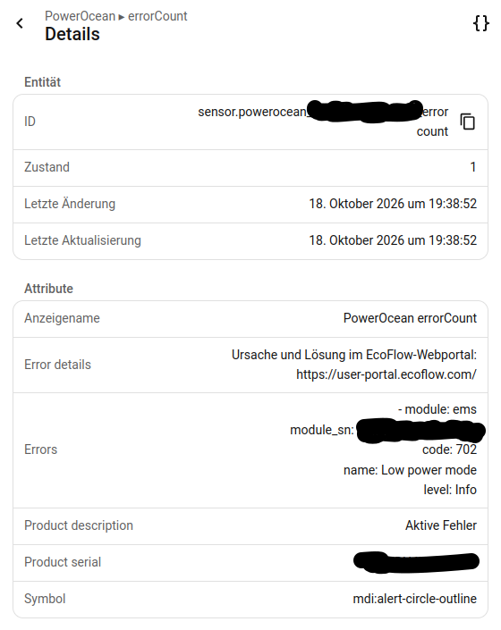
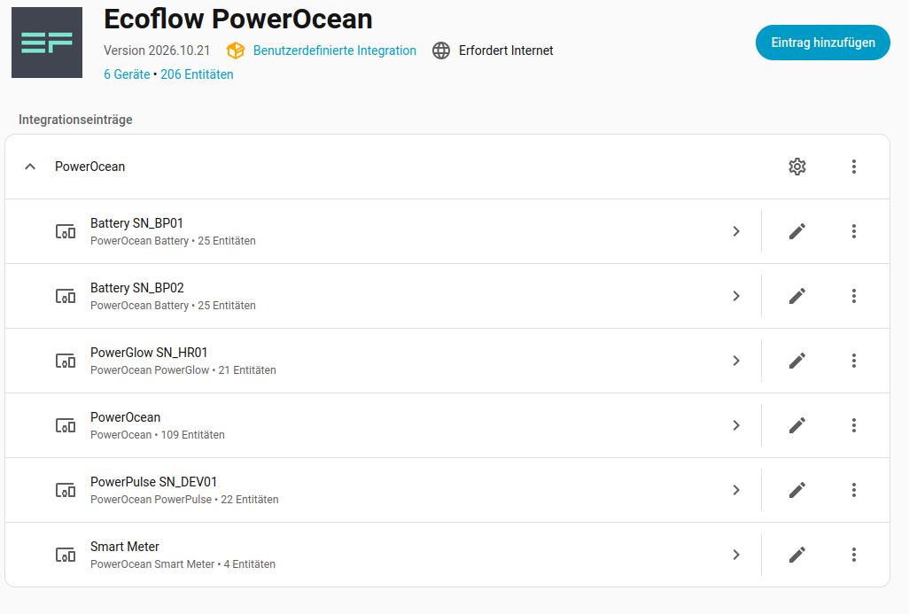
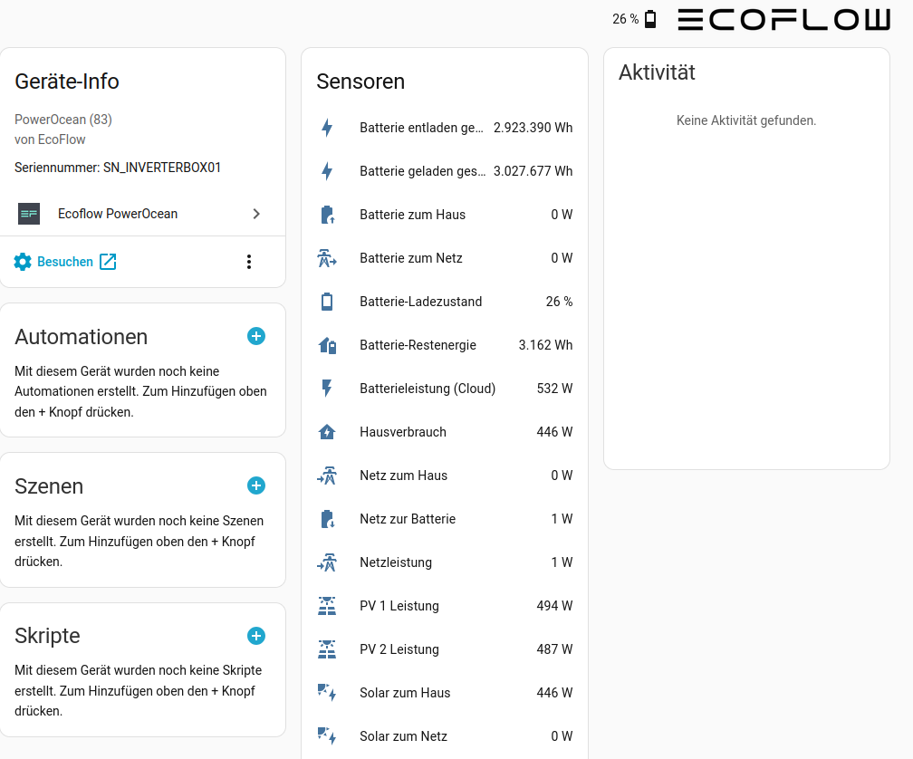
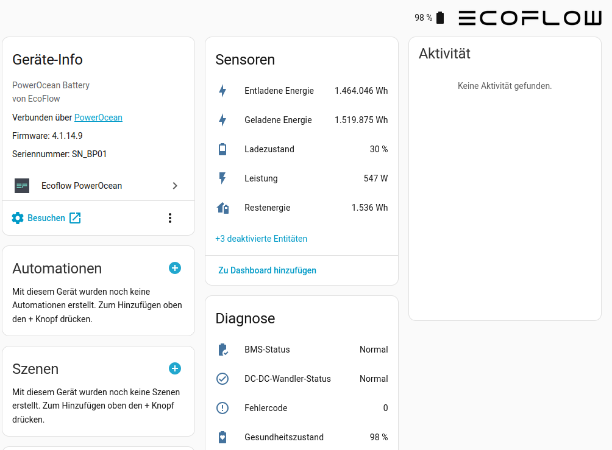
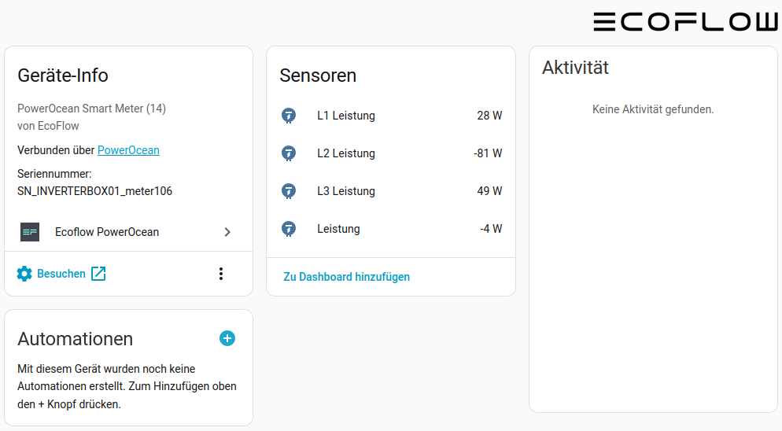

<!-- prettier-ignore -->
# Ecoflow PowerOcean
[](https://github.com/niltrip/powerocean/releases/)
[](https://github.com/niltrip/powerocean/issues)
[](https://github.com/niltrip/powerocean)
[](https://github.com/niltrip/powerocean/commits/main)
[](https://github.com/hacs/integration)
[](https://github.com/niltrip/powerocean/actions?query=workflow:"Validate")


[Home Assistant](https://home-assistant.io/) custom component to get access to my EcoFlow PowerOcean system.

This component was inspired by [tolwi/hassio-ecoflow-cloud](https://github.com/tolwi/hassio-ecoflow-cloud) and is a copy of [evercape/hass-resol-KM2](https://github.com/evercape/hass-resol-KM2).

## Disclaimers

⚠️ Temporary quick solution to my problem ("Nothing is more persistent than a makeshift solution.").
I hope for an integration of PowerOcean into [tolwi/hassio-ecoflow-cloud](https://github.com/tolwi/hassio-ecoflow-cloud) with an official API.

Nevertheless, I hope that it works for others as well.

## Prerequisites

- Home Assistant **2025.8.0** or newer
- The serial number (S/N) of your inverter, as shown in the EcoFlow app
- The e-mail address and password of your EcoFlow account

I have tested the component with my system.
I use the Android app and the web portal at https://user-portal.ecoflow.com/

## Installation

- Install as a custom repository via HACS
- Manually download and extract to the custom_components directory

Once installed, use Add Integration -> Ecoflow PowerOcean.

## Configuration

Follow the flow.


### Extended connection (MQTT, optional)

Off by default. Switch it on under *Settings → Devices & services → Ecoflow PowerOcean → ⚙ (Configure) → Extended connection (MQTT)*.

The integration then additionally connects to the EcoFlow cloud the way the EcoFlow app does (MQTT, with the same account) and asks the system for its full state – after connecting, after each reconnect and every 6 hours. From the answer it reads the firmware of the modules:

- **PowerOcean (inverter):** the firmware of the energy management (EMS), e.g. 5.1.38.5. The "system version" the app shows (e.g. 5.1.37.13) is the name of the whole update package and is not sent.
- **Smart meter:** its firmware.
- The other modules (inverter power stage, Wi-Fi) are listed in the diagnostics.

**LED brightness:** With the option on, the inverter also gets a slider "LED brightness" (0–100 % in steps of 10, under *Configuration* on its device page). It sends the same command as the app and waits for the system to confirm it; if the system does not confirm it within 10 s, Home Assistant shows an error. A change in the app is shown right away as well.

**Backup reserve:** A second slider "Backup reserve" (0–100 % in steps of 1) sets the backup reserve as in the app. The system keeps it as the lowest state of charge for discharging (`sysBatDsgDownLimit`, the sensor "Backup reserve (discharge limit)"). The app's command also contains the charge limit and a value `devSoc`; the integration sends their current values unchanged, so it only changes the backup reserve. While it does not know them yet (e.g. right after the start), the slider is unavailable.

All other values still come from the regular polling. The LED brightness and the backup reserve are the only settings the integration changes. If the connection fails, the integration keeps working and logs a warning; the sliders are then unavailable. When you switch the option off, the sliders and the firmware of the inverter and the smart meter are removed again.


### Sensors
Sensors are registered to their device as `sensor.{device_name}_{sensor_name}`, where `sensor_name` is the name of the value in the EcoFlow API. The entity ID does not depend on the language.
The friendly name is readable, in English or German depending on the language of Home Assistant, e.g. "State of charge" for `bpSoc`. Values whose meaning is not known yet keep `sensor_name` as friendly name.
The unique ID is `{serial}_{report}_{sensor_name}`, e.g. `{serial}_JTS1_EMS_HEARTBEAT_pcsMeterPower`, or `{serial}_{sensor_name}` for values outside a report.

Each sensor has these attributes:
- `product_description`: description of the value, if known (otherwise its name)
- `product_serial`: serial number of the device the value belongs to

### Active errors
The sensor `errorCount` (description "Aktive Fehler") of each inverter counts the errors the system currently reports, as the app shows them: from the EMS, the inverter (PCS) and the battery packs.
Its attribute `errors` lists each active error with module, serial number of the module and error code; for known codes also name and level (Info, Warning, Error):

```yaml
errors:
  - module: ems
    module_sn: ...
    code: 521
    name: Energy storage communication error
    level: Warning
```

Cause and solution are only available in the [EcoFlow web portal](https://user-portal.ecoflow.com/); the attribute `error_details` points there. The link "Visit" on the device page opens the portal as well.

Since Home Assistant 2026.2 the dialog of a sensor no longer lists its attributes; open them via ⋮ → Details:



### Which values update, and which do not

The EcoFlow cloud does not refresh all values at the same rate. Some of them keep returning the same number for hours. The integration reports what the API hands it, so a flat line here is not a bug in this component.

Measured on 2026-10-25 with `scripts/interval` (one request every 10 s) on a three-phase PowerOcean with two batteries: two hours with the app closed and the PowerInsight display switched off, then seven minutes with the PowerInsight display on:

| group | reports | changes in 2 h | interval between changes |
|---|---|---|---|
| live measurements: grid, solar, battery and phase power | `EMS_HEARTBEAT` | 118 | 40–80 s, typically 50 s |
| state, settings and counters of the system | `EMS_CHANGE_REPORT` | 289 | 20–30 s |
| power distribution to wallbox and heating rod | `EDEV_SYS_REPORT` | 98 | irregular, 20 s to 8.5 min, typically 40 s |
| battery packs | `BP_STA_REPORT` | 28 | about 5 min |
| cloud values | `data`, `ENERGY_STREAM_REPORT`, `EMS_PV_INV_ENERGY_STREAM_REPORT` | 7–9 | without app or PowerInsight: only once, for 2.5 minutes, every 25 s (cause unknown); otherwise unchanged. The two other changes of `data` came about one hour apart (energy totals). **With the PowerInsight display on: every 20–30 s** |
| parameters and errors | `EMS_PARAM_CHANGE_REPORT`, `ERROR_CHANGE_REPORT`, `LOGY_DEV_REPORT` | 0 | content unchanged (no errors during the measurement); only `updateTime` is renewed every 15 min |
| configuration: schedules, time-of-use tasks, device lists, priorities | `TOU_ALL_TASK_REPORT`, `*_TIMER_TASK_REPORT`, `*_BIND_LIST_REPORT`, `EDEV_PRIORITY_LIST_REPORT`, `ERROR_CODE_MASK_REPORT` | 0 | change only when a setting changes |

What this means:

- The values that matter for a dashboard (`EMS_HEARTBEAT`, `EMS_CHANGE_REPORT`) arrive every 20–80 s on their own. The default scan interval of 10 s catches each change; a shorter one brings no fresher data.
- The values from `data` and `ENERGY_STREAM_REPORT` stay old while nothing asks the cloud for them – an open app or a PowerInsight display that is switched on makes the cloud refresh them every 20–30 s. All other reports keep their rhythm either way. Over 72 hours, @Kantripal saw `mpptPwr` and `pv1Pwr` stuck at 0 W while `mpptPv_pwrTotal` from the heartbeat changed more than 2100 times; on 2026-08-21 at 13:16 the same response held 0 W and 4238 W for the same solar power.
- Battery pack values (cell voltages, temperatures, state of health) lag up to 5 minutes. For the battery state of charge and power, use the system values from `EMS_CHANGE_REPORT` and `EMS_HEARTBEAT`.
- `updateTime` in the reports is in UTC+8 (China time). The integration converts it for the "time of the last values" sensors.

For a dashboard, take the values from `EMS_HEARTBEAT`:

- grid: `pcsMeterPower` (positive = import, negative = export) rather than `sysGridPwr`
- solar: `mpptPv_pwrTotal` (sum of the PV strings) rather than `mpptPwr`, `pv1Pwr` or `pvInvPwr`
- battery: `emsBpPower` rather than `bpPwr`
- house: `housePower`, which is calculated from the three values above

The friendly names point the way: values from `data` and `ENERGY_STREAM_REPORT` end in "(cloud)", e.g. "House consumption (cloud)", the calculated values have no suffix, e.g. "House consumption".
In dual systems (master and slave inverter), the values from `PARALLEL_ENERGY_STREAM_REPORT` end in "(energy flow)". According to [#23](https://github.com/niltrip/powerocean/issues/23) they are updated regularly, unlike those from `data`.

### Devices
Each part of the system is a device of its own, named by its serial number and linked to the inverter. The serial number and, where the cloud reports it, the firmware are shown in the device info; the link "Visit" opens the EcoFlow web portal.



**PowerOcean (inverter):** live values, calculated energy flows and the state of the system. The model ID in brackets is the product type you chose at setup (83 = PowerOcean).



**Battery packs:** state of charge, power, energy and state of health per pack; the firmware is shown in the device info.



**Smart meter:** power of each phase and the total, for three-phase meters. The number in brackets is the meter type.



**PowerGlow heating rod** and **PowerPulse wallbox**, if present: temperatures, heating power and mode; charging power, currents, mode and the last charging session. Values marked "(cloud)" are probably only refreshed while the app is open, like the other cloud values above.


Apart from the LED brightness, this integration only reads values. To control the PowerGlow or the PowerPulse 2 (mode, target temperature, charging current, …), have a look at the integrations by [Xygen](https://github.com/Xygen): [EcoFlow PowerGlow for Home Assistant](https://github.com/Xygen/EcoFlow-PowerGlow-for-Home-Assistant) and [EcoFlow PowerPulse 2 for Home Assistant](https://github.com/Xygen/EcoFlow-PowerPulse-2-for-Home-Assistant).


### Energy dashboard
The EcoFlow API reports energy counters only for some values. These can be used in the energy dashboard as they are:

- solar production: `totalElectricityGeneration`, shown as "Solar energy total" (kWh, changes about once per hour)
- battery: `bpTotalChgEnergy` ("Battery charged energy") and `bpTotalDsgEnergy` ("Battery discharged energy")

There is no counter for the single PV strings and none for the grid.

- **PV strings, or solar with finer steps:** turn the power into energy with an [integral sensor](https://www.home-assistant.io/integrations/integration/). It can be created in the UI (Settings → Devices & services → Helpers → Integral sensor) or in YAML. [config/configuration.yaml](config/configuration.yaml) contains an example for all strings together and for each string.
- **Grid import and export:** read your electricity meter locally, e.g. with a Tasmota reading head or a Shelly. The values come straight from your network instead of through the EcoFlow cloud, and they match what the meter shows. On my system the grid values from the cloud do not match the readings on my meter, so I would not build an energy counter on them.

The same file contains template sensors for the battery: remaining charge time, remaining discharge time and the time the battery will be empty. Set the capacity and the backup reserve of your system there, and replace `SN` in the entity IDs with the serial number of your inverter.


## Troubleshooting

**Diagnostics:** When you report a problem, please attach the diagnostics:
*Settings → Devices & services → Ecoflow PowerOcean → ⋮ → Download diagnostics*.
The file contains the last response of the EcoFlow cloud and the detected devices. Credentials, system name, location and time zone are removed, serial numbers are replaced by placeholders (`SN_MAIN`, `SN_BP01`, ...).

**Login:** If EcoFlow rejects the credentials (e.g. after you changed your password), Home Assistant asks you to sign in again. If the cloud cannot be reached, the integration retries on its own.

**Debug logging:** For more details, set the logging of this custom component to debug. If everything works well, you can remove it again:

```yaml
logger:
  default: warn
  logs:
    custom_components.powerocean: debug
```

## Credits

Thanks to my colleague David for giving me a starting point.

Thanks to [shuette42](https://github.com/shuette42) for [ecoflow-energy-ha](https://github.com/shuette42/ecoflow-energy-ha): its protobuf definitions made the MQTT messages readable.

Thanks to [Xygen](https://github.com/Xygen) for the diagnostics of a PowerGlow and a PowerPulse 2 and for the verified value mappings in his [PowerGlow](https://github.com/Xygen/EcoFlow-PowerGlow-for-Home-Assistant) and [PowerPulse 2](https://github.com/Xygen/EcoFlow-PowerPulse-2-for-Home-Assistant) integrations ([#132](https://github.com/niltrip/powerocean/discussions/132)).

And also thanks for the great work of the team from homeassistant and the great community.